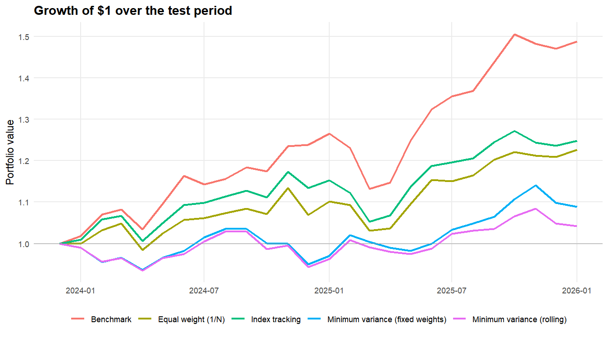
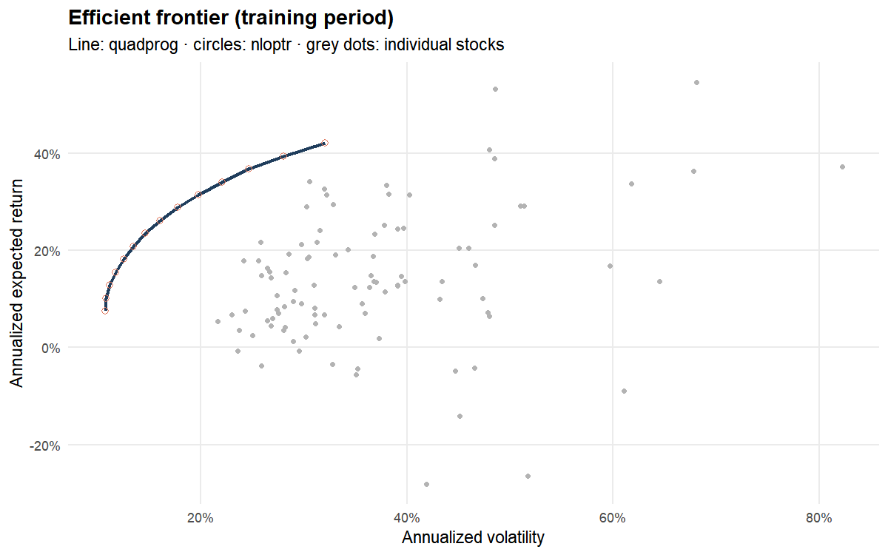
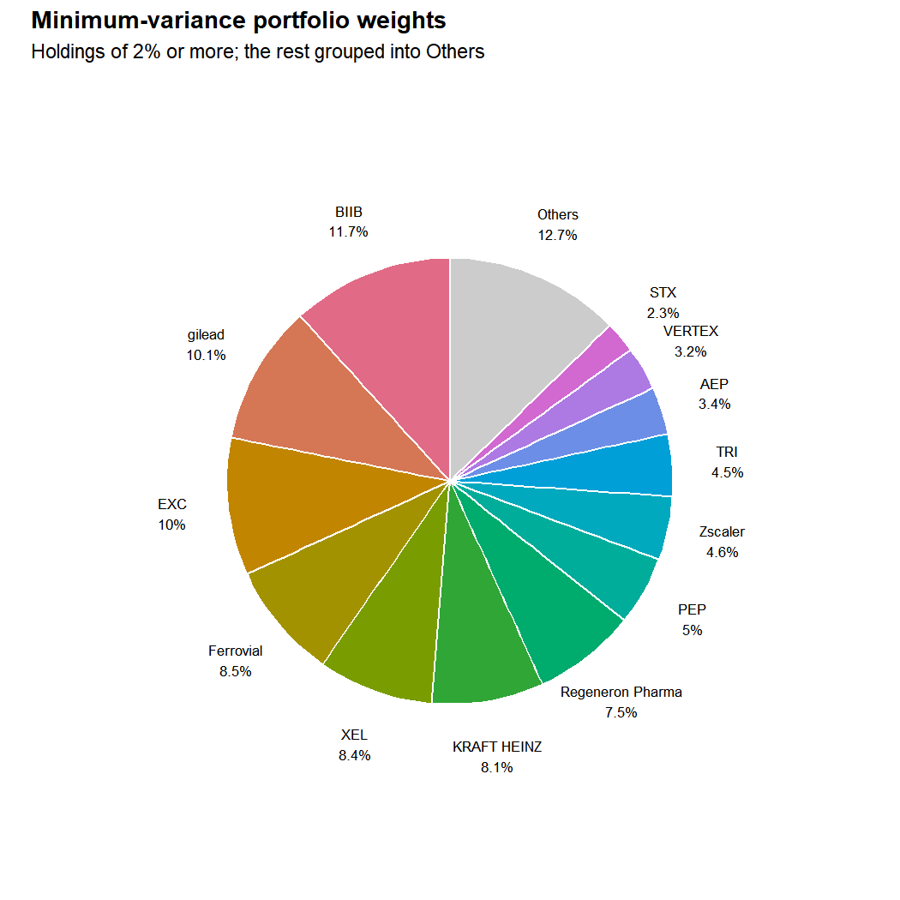

# Constrained Portfolio Optimization (R)

Construction and evaluation of equity portfolios from monthly returns: minimum-variance,
index tracking and efficient frontier, with a comparison of two solvers and an
**out-of-sample evaluation**.

## What the script does

1. **Training period** (first 48 months, 2020 → 2023), where every estimate is made:
   - covariance estimated with **Ledoit-Wolf shrinkage**. With more stocks than months,
     the sample covariance is singular and the optimizer would exploit estimation noise;
   - constrained **global minimum-variance** portfolio (long-only, 0.01% ≤ wᵢ ≤ 20%);
   - **index-tracking** portfolio (tracking error minimization);
   - **efficient frontier** solved with two methods: exact quadratic programming
     (`quadprog`) and SLSQP nonlinear optimization (`nloptr`), comparing the resulting
     volatilities and the largest weight gap between the two.
2. **Test period** (25 months, 2024 → January 2026, never used for any estimation):
   - minimum-variance with fixed weights (estimated on the training period);
   - **rolling** minimum-variance: weights re-estimated every month on all data available so far;
   - index tracking, equal-weight (1/N) portfolio and benchmark as references.
3. **Metrics** (written in base R, no black box): annualized return and volatility, Sharpe,
   Sortino, Omega, beta, Treynor, Jensen's alpha, max drawdown, Calmar, historical 95% VaR
   and ES, tracking error, information ratio.

## Results

> Over the 25-month test period (2024 → January 2026), **no optimized portfolio beat the
> Nasdaq-100 benchmark**. Minimum-variance cut volatility by about a quarter, but at the cost
> of most of the return, and the tracking portfolio stayed highly correlated with the index
> while lagging it by 9 points a year.

| Out-of-sample (25 months) | Benchmark (ETF) | Equal weight (1/N) | Min-variance (fixed) | Min-variance (rolling) | Index tracking |
|---|---|---|---|---|---|
| Annualized return | **20.0%** | 10.4% | 4.5% | 2.4% | 11.3% |
| Annualized volatility | 13.1% | 11.2% | 9.5% | **9.1%** | 11.3% |
| Sharpe ratio | **1.21** | 0.56 | 0.04 | −0.20 | 0.63 |
| Max drawdown | −10.6% | −9.0% | −8.3% | **−8.3%** | −10.3% |
| Tracking error | — | 6.8% | 14.7% | 14.4% | **4.5%** |
| Correlation with benchmark | 1.00 | 0.86 | 0.19 | 0.20 | **0.94** |

Full table (Sortino, Omega, beta, Treynor, Jensen's alpha, Calmar, VaR, ES, information
ratio): `outputs/metrics_out_of_sample.csv`.

What the numbers say:

- **The test period favoured the benchmark by construction.** 2024–2025 was driven by a few
  mega-cap tech stocks that dominate the cap-weighted index; any portfolio that spreads its
  weights (1/N, bounds of 0.01%–20%) mechanically lags in such a market.
- **Minimum-variance did its job on risk, not on return.** It picked defensive names (Biogen,
  Gilead, Exelon, Kraft Heinz…), only 0.19 correlated with the index, which lowered volatility
  and drawdown but missed the rally.
- **Rolling re-estimation did not help** (2.4% vs 4.5%): with only 48–72 months of history,
  monthly re-optimization mostly adds estimation noise, before any transaction cost.
- **The two solvers agree.** quadprog (exact quadratic programming) and nloptr (iterative
  SLSQP) return the same weights along the frontier (`outputs/solver_comparison.csv`),
  which validates the optimization.





## Data

Excel file `returns.xlsx` (placed next to the script, **not included in this repository**
because the data were extracted from a licensed database): **simple monthly returns** of 99
Nasdaq-100 stocks, January 2020 → January 2026 (73 months).

| Column | Content | Use |
|---|---|---|
| `Date` | month | — |
| `ETF` | return of a Nasdaq-100 ETF | **benchmark** |
| `Bond` | monthly change in the US 10-year yield, in percentage points | yield level rebuilt from 1.92% (31 Dec 2019), then converted into a monthly risk-free rate |
| `INDEX` | — | **ignored**: series in reversed chronological order with the opposite sign (correlation of −0.98 with the ETF once reversed) |
| other columns | stock returns | investment universe |

Costco is removed from the universe (4 missing months in 2025) rather than deleting those
months for every stock. The rebuilt yield (0.53% at its 2020 low, 4.17% in January 2026) is
consistent with the history of the US 10-year yield.

## How to run

```r
# from the project folder
source("portfolio_optimization.R")
```

Parameters (data path, training length, weight bounds, risk-free rate format) are grouped
at the top of the script. Results: `outputs/*.csv`, charts: `outputs/figures/`.

## Limitations

- The test period is short (25 months): performance differences between strategies are
  not statistically significant.
- The risk-free rate is proxied by the 10-year yield (no short-term rate in the data).
- Expected returns (frontier) are historical means and very noisy; the frontier is
  illustrative. Minimum-variance, which does not use expected returns, is the most robust
  portfolio of the set.
- No transaction costs, although the rolling portfolio changes weights every month.
